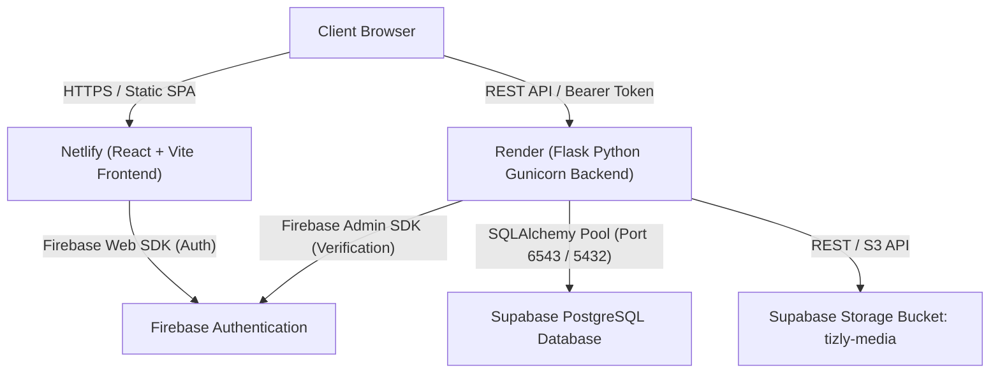

# 🚀 Tizly Full-Stack Deployment Master Guide

This document is the master deployment guide for the **Tizly** platform.

---

## 🏗️ Architecture & Hosting Strategy



---

## 📚 Dedicated Deployment Guides

Detailed, click-by-click instructions for each service:

1. **[Backend Deployment (Render + Supabase + Firebase Admin)](./RENDER_BACKEND_DEPLOYMENT.md)**
   - Creating the Render Web Service from `backend/`
   - Setting up environment variables and Gunicorn
   - Adding Firebase Service Account credentials securely
   - Health check endpoints (`/health` and `/`)

2. **[Frontend Deployment (Netlify + React 19 + Vite)](./FRONTEND_DEPLOYMENT.md)**
   - Importing the repository from `frontend/`
   - Configuring `netlify.toml` and SPA routing (`/* -> /index.html 200`)
   - Setting `VITE_BACKEND_URL` pointing to Render
   - Authorizing Netlify domain in Firebase Authentication

---

## ⚡ Deployment Sequence Summary

For the smoothest setup, deploy in this exact order:

```text
Step 1: Deploy Backend to Render (RENDER_BACKEND_DEPLOYMENT.md)
   │
   ├──> Wait for Render build to finish and obtain: https://<your-backend>.onrender.com
   └──> Verify https://<your-backend>.onrender.com/health returns 200 OK
   │
Step 2: Deploy Frontend to Netlify (FRONTEND_DEPLOYMENT.md)
   │
   ├──> Provide VITE_BACKEND_URL = https://<your-backend>.onrender.com
   └──> Deploy and obtain: https://<your-site>.netlify.app
   │
Step 3: Authorize Netlify Domain in Firebase Console
   │
   └──> Firebase Console -> Authentication -> Settings -> Authorized Domains -> Add your Netlify URL
```
